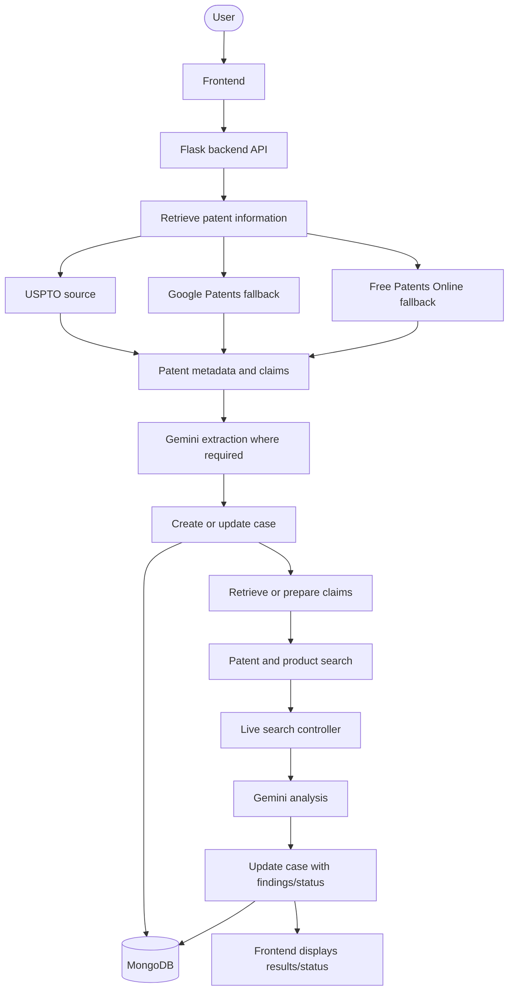

# Existing Patent Gap AI Workflow Analysis

> **Document status:** Codebase exploration and workflow analysis  
> **Scope:** This document records the existing backend workflow as understood from the `main` branch files inspected during research. It is not a claim that every frontend/backend path has been verified in a running deployment. Re-check endpoint names and call paths against the current branch before implementation.

## 1. Purpose

The purpose of this document is to understand how the existing Patent Gap AI application receives a patent, retrieves patent information, prepares claims, performs patent/product searches, uses Gemini for analysis, and stores investigation data.

This analysis is useful before adding new agent orchestration or persistent memory because the team should extend existing capabilities rather than rebuild them unnecessarily.

## 2. Existing technology and components observed

The repository exploration identified:

- **Backend:** Python with Flask-style API routes.
- **Database:** MongoDB.
- **LLM integration:** Gemini functions in `Backend/llm_brain/gemini.py`.
- **Patent/product search:** `Backend/live_search/liveSearchController.py`.
- **Case persistence:** `Backend/models/cases.py`.
- **Document persistence:** `Backend/models/documents.py`.
- **Search history:** `Backend/models/search_history.py`.
- **Frontend entry point examined:** `Frontend/home-new.html`.

The existing application already has case, document and search-history persistence. A new memory feature should be designed around these existing components and the team's agreed storage strategy.

## 3. High-level existing workflow

This diagram is a simplified representation of the code paths examined. Exact source selection, error paths, and endpoint invocation should be checked in the current code.

## 4. Workflow stages and relevant code

### Stage 1 — User submits a patent ID

The frontend file examined was:

- `Frontend/home-new.html`

The code exploration identified a frontend function named `fetchCasefromUspto()` and a backend route referenced as:

- `/api/fetch-patent-from-uspto`

The user provides a patent identifier, and the frontend sends a request to the backend.

**Questions to verify in the current branch:**
- What input validation is applied?
- What fields are mandatory?
- What response schema does the frontend expect?
- How are invalid or unavailable patent IDs reported?

### Stage 2 — Patent information retrieval

The backend attempts to retrieve patent information from external sources. The code explored included a USPTO retrieval path and fallback retrieval through Google Patents and Free Patents Online.

The exact fallback order and conditions should be confirmed from the current implementation before changing this stage.

### Stage 3 — Metadata and claim extraction

Relevant file:

- `Backend/live_search/liveSearchController.py`

A function identified during exploration:

- `passToGeminiForMetadata()`

Gemini is used in the extraction path to prepare patent metadata and claims from retrieved information where required.

Potential extracted information includes patent title, dates, description and claims. The exact output schema must be taken from the current function implementation.

### Stage 4 — Case persistence

Relevant files:

- `Backend/database.py`
- `Backend/models/cases.py`

The existing case model supports creating, retrieving and updating case information, including patent details and infringement-related results.

The repository also contains:

- `Backend/models/documents.py`
- `Backend/models/search_history.py`

These indicate that document and search-history data have their own persistence paths.

**Design implication:** Before introducing a new storage layer, determine which information already exists in cases, documents and search history and which additional memory records are genuinely needed.

### Stage 5 — Claims retrieval or extraction

The route explored in `Backend/app.py` included:

- `/api/get-claims/<case_id>`

The observed flow checks whether claims are already available and can return existing claims. If claims are not available, the backend can prepare them from patent document content using the relevant extraction function, then update the case.

Verify the current implementation's exact conditions and response format before relying on this behaviour.

### Stage 6 — Patent and product source searches

Relevant file:

- `Backend/live_search/liveSearchController.py`

Functions identified during repository exploration included:

- `searchPatentSources()`
- `searchProductSources()`

The patent search path gathers potentially relevant patent sources. The product search path generates or uses search queries and gathers product information.

The controller uses Gemini-related functionality to support query generation and analysis. The exact sources, scraping behaviour, and evidence fields should be confirmed in the current code.

### Stage 7 — Gemini analysis

Relevant file:

- `Backend/llm_brain/gemini.py`

The module contains Gemini-based functionality for patent metadata/claims extraction, infringement analysis, search-query generation and product-related analysis.

The intended high-level purpose is to compare reference patent claims with information retrieved from candidate patents or products. The output should be treated as preliminary AI analysis and not as a definitive legal conclusion.

### Stage 8 — Persist results and report status

The case model supports updating case records with infringement-related results. The backend also tracks investigation/search status in relevant parts of the application.

The exact lifecycle of statuses, report generation and frontend rendering should be traced end-to-end before integration work.

## 5. Code navigation guide

| Order | File | What to inspect |
|---|---|---|
| 1 | `Frontend/home-new.html` | User action, request payload, expected response |
| 2 | `Backend/app.py` | API routes and workflow entry points |
| 3 | `Backend/live_search/liveSearchController.py` | Patent/product retrieval and search orchestration |
| 4 | `Backend/llm_brain/gemini.py` | Gemini prompts, extraction and analysis outputs |
| 5 | `Backend/models/cases.py` | Case creation, retrieval and updates |
| 6 | `Backend/models/documents.py` | Document persistence |
| 7 | `Backend/models/search_history.py` | Search-history persistence |
| 8 | `Backend/database.py` | MongoDB connection and database operations |

## 6. Important verification issue

During the earlier repository exploration, the frontend contained a reference to:

- `/api/gemini-infringement-analysis/<case_id>`

The backend route examined appeared to expose:

- `/api/similarity-analysis-live/<case_id>`

This may indicate an outdated frontend reference, a different branch/version, or another route not yet traced. Do not assume these endpoints are interchangeable. Verify the current branch, search all route definitions and frontend calls, and test the running application before documenting the final endpoint contract.

## 7. Where the proposed multi-agent workflow may connect

The internship team's diagrams describe a proposed architecture with:

- Ardra: API and request intake.
- Jinsy: orchestration and task committees.
- Neethu: scraping and guardrails.
- Reshma: Book, Logs, Rules and Clarifications.

These names and modules are part of the team's proposed internship architecture. They should not be assumed to exist in the current backend until confirmed in the repository.

Potential connection points to investigate:

1. The API entry point after patent input validation.
2. Case creation or loading, where a Book ID could be associated with an existing case.
3. Before analysis, where relevant historical context could be retrieved.
4. After source collection and validation, where approved findings could be recorded.
5. When reports and claim charts are generated, where artefact references could be attached to the Book.
6. The status endpoint, where investigation progress could be exposed.

## 8. Questions for code review

- What is the exact route and call chain from the frontend patent submission to case creation?
- Which external source is queried first, and what triggers fallback?
- What is the canonical schema for patent metadata and claims?
- Where are raw source documents stored?
- Which function starts patent/product infringement analysis?
- How are search results, Gemini outputs and final results linked to a case?
- What status values are stored, and where are they updated?
- Are investigation runs versioned or identified with a unique run ID?
- Which user corrections or attorney notes are currently persisted?
- What information should be stored in a new Record Keeper layer rather than duplicated?

## 9. Summary

The existing Patent Gap AI backend already includes patent retrieval, Gemini-based extraction and analysis, search functionality, MongoDB connectivity, and case/document/search-history persistence.

The next step is not to rebuild those capabilities. It is to verify the exact current execution path and identify the missing integration points for orchestration, quality checks and persistent investigation memory.

---

**Research note:** Update this document as the current branch is inspected and tested. Distinguish confirmed code behaviour from proposed internship architecture.
