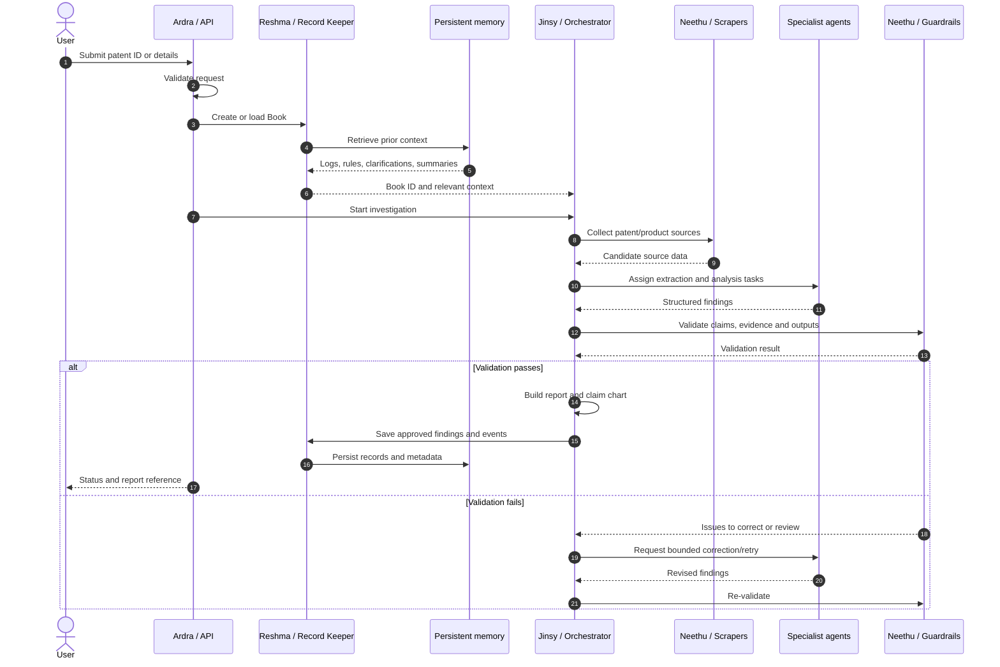
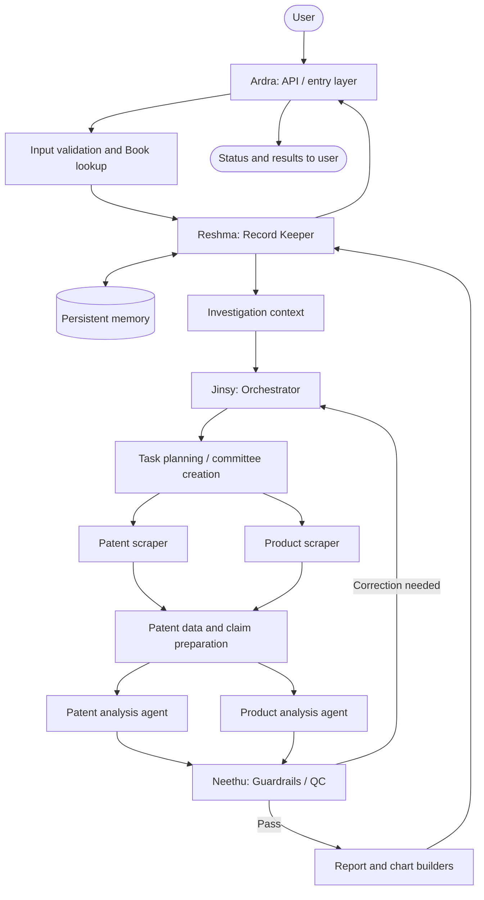
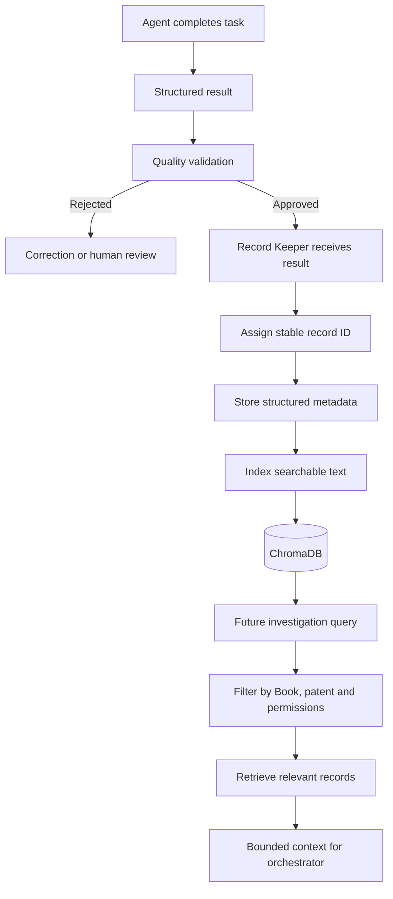

# Multi-Agent Architecture and Investigation Workflow

> **Status:** Research and design document. This document combines responsibilities shown in the team's diagrams with a proposed integration workflow. It does not claim that all components are implemented.

## 1. Purpose

This document describes a proposed multi-agent architecture for an AI-assisted patent investigation workflow. The team diagrams identify four responsibility areas:

- **Ardra — Front Desk / API:** request intake, endpoint initialisation, patent input, workbook creation/listing, analysis initiation and status checks.
- **Jinsy — Orchestrator:** model loading, agent and committee creation, task coordination, patent/product mining, analysis, report building and chart building.
- **Neethu — Scraping and Quality Control:** patent/product scraping and validation of claims, metadata, clarifications, blacklists, chart/matrix entries, cross-claim connections and URLs.
- **Reshma — Record Keeper:** Book/workbook structure, logs, rules, clarifications, historical summaries, patent data, infringement findings and report/chart references.

The goal is to coordinate these responsibilities through explicit interfaces, traceable task handoffs and validated investigation records.

## 2. High-level architecture


The image is a conceptual overview. The detailed diagrams below express the proposed workflow more precisely.

### 2.1 Responsibility map

| Area | Owner | Diagram files | Responsibilities |
|---|---|---|---|
| API / entry | Ardra | `app.py`, `input_functions.py` | Initialise endpoints; accept patent details/ID; create and list workbooks; start analysis; check status |
| Orchestration | Jinsy | `models.py`, `task_committees.py` | Load models; create agents/committees; coordinate patent/product mining, analysis, reports and charts |
| Scraping / QC | Neethu | `scraper.py`, `guardrails.py` | Scrape patent and product sources; validate claims, metadata, clarifications, blacklists, chart/matrix entries and URLs |
| Memory / records | Reshma | `book_structure.py`, `log_structure.py`, `rules_structure.py`, `clarification_structure.py` | Create/load/save Books; append and retrieve logs; manage rules and clarifications; organise investigation artefacts |

The role names and function names above come from the team's diagrams. Exact function signatures, call order, data schemas and error-handling contracts still need to be confirmed against the implementation.

## 3. End-to-end investigation workflow

### 3.1 Proposed sequence

1. **Request intake:** a user submits a patent ID or patent details through the API.
2. **Input validation:** the entry layer validates required fields and checks whether a relevant Book exists.
3. **Book initialisation:** create or load a Book using stable identifiers such as `book_id` and `patent_id`.
4. **Analysis request:** the API layer asks the orchestrator to start the investigation.
5. **Memory retrieval:** the Record Keeper retrieves relevant previous logs, rules, clarifications and summaries within the correct access scope.
6. **Task planning:** the orchestrator selects/creates agents or committees and assigns tasks.
7. **Source collection:** patent and product scrapers collect candidate source material.
8. **Data preparation:** patent metadata and claims are isolated and classified into structured data.
9. **Analysis:** specialist agents compare patent-to-patent and patent-to-product information.
10. **Quality checks:** guardrails validate claims, metadata, source URLs, blacklists, chart entries, matrix entries and cross-claim connections.
11. **Correction/retry:** invalid or incomplete results are returned for bounded correction or human review.
12. **Report generation:** report and chart builders prepare structured outputs.
13. **Record keeping:** approved findings, task events, relevant rules, clarifications and artefact references are saved.
14. **Result delivery:** the API layer exposes status and makes the result available to the user.

This is a **proposed integration sequence**, not a verified description of the current runtime call order.

### 3.2 Sequence diagram



### 3.3 Component and data-flow diagram



## 4. Orchestration and agent communication

The team's diagram assigns Jinsy responsibility for model loading, agent creation, committee creation and task coordination. This resembles a **supervisor-style architecture**: a central orchestrator delegates work to specialist agents and combines their outputs.

A task handoff should define:

- `task_id`: unique identifier for the task.
- `book_id` and `patent_id`: investigation scope.
- `task_type`: e.g. patent source mining or product analysis.
- `assigned_agent`: specialist responsible for the task.
- `input`: structured data required by the agent.
- `context_refs`: references to relevant prior records, not an unfiltered memory dump.
- `status`: `pending`, `running`, `completed`, `failed` or `needs_review`.
- `output_ref`: reference to the structured result.
- `error`: machine-readable error details, if any.

### 4.1 Illustrative task envelope

```json
{
  "task_id": "task-001",
  "book_id": "book-001",
  "patent_id": "US-EXAMPLE",
  "task_type": "product_source_mining",
  "assigned_agent": "product_source_miner",
  "status": "pending",
  "input": {
    "keywords": ["wireless charging"],
    "claims": [],
    "search_constraints": {}
  },
  "context_refs": [],
  "output_ref": null,
  "error": null
}
```

This is an example contract, not an existing project schema. The team should agree on field names and validation rules before integration.

### 4.2 Recommended orchestration practices

1. Keep routing and task-state decisions in the orchestrator.
2. Pass each agent only the context it needs.
3. Prefer structured outputs over free-form prose for handoffs.
4. Validate outputs before they enter reports or persistent memory.
5. Use correlation IDs (`request_id`, `book_id`, `task_id`) to trace execution.
6. Define timeouts, retry limits and terminal failure states.
7. Provide human review for uncertain or legally significant conclusions.

## 5. Scraping, quality control and evidence provenance

The guardrail functions in the team diagram make validation a distinct stage of the workflow.

Potential checks include:

- Isolated claims are correctly structured.
- Extracted metadata is consistent with its source.
- Blacklisted patents and products are excluded.
- Evidence URLs are valid and relevant.
- Claim-chart and matrix entries contain required fields.
- Cross-claim connections are supported by evidence.
- Important findings can be traced to their source material.

An illustrative finding record:

```json
{
  "finding_id": "finding-001",
  "book_id": "book-001",
  "patent_id": "US-EXAMPLE",
  "claim_reference": "claim-1",
  "candidate_product": "Example product",
  "finding_text": "Potential technical similarity identified.",
  "evidence": [
    {
      "source_url": "https://example.org/source",
      "source_title": "Product technical specification",
      "supporting_excerpt": "Relevant source passage",
      "retrieved_at": "2026-11-14T10:00:00Z"
    }
  ],
  "validation_status": "needs_review",
  "reviewed_by": null
}
```

All values are placeholders. Use actual source URLs and excerpts only when collected.

**Legal boundary:** a similarity score or preliminary claim chart is not, by itself, a legal conclusion that infringement has occurred. Outputs should communicate evidence, uncertainty and the need for qualified legal review.

## 6. Record Keeper and persistent memory

The team's Book diagram includes current logs, historical log summaries, analysis rules, claim isolation/classification rules, user clarifications, patent data, infringements, charts, reports and matrices.

### 6.1 Suggested storage responsibilities

| Data | Suggested handling |
|---|---|
| Exact IDs, status, timestamps, ownership and structured Book fields | Store as structured records with stable identifiers |
| Long-form logs, findings, clarifications and summaries | Store text with metadata; index for semantic retrieval where useful |
| Rules and instructions | Store versioned structured records; retrieve only applicable rules |
| Reports, charts and matrices | Store structured output or file references with provenance |
| Original patent documents and large binaries | Keep in the existing document-storage mechanism where appropriate |

### 6.2 Possible ChromaDB collections

ChromaDB can store documents, embeddings and metadata in collections and retrieve semantically similar records.

| Collection | Purpose |
|---|---|
| `investigation_logs` | Search previous investigation events and findings |
| `historical_summaries` | Retrieve compact summaries of earlier work |
| `analysis_rules` | Retrieve relevant reusable rules |
| `user_clarifications` | Retrieve relevant corrections and explanations |
| `patent_knowledge` | Retrieve patent-specific notes and technical context |

Possible metadata fields:

- `book_id`
- `patent_id`
- `record_id`
- `record_type`
- `owner_id` or organisation scope
- `created_at`
- `version`
- `source_ref`
- `validation_status`

Metadata filters should restrict retrieval to the correct patent, Book, organisation and permission scope. Semantic similarity is **not** an access-control mechanism.

### 6.3 ChromaDB learning example

```python
import chromadb

client = chromadb.PersistentClient(path="./local_chroma")

logs = client.get_or_create_collection(
    name="investigation_logs"
)

logs.upsert(
    ids=["log-001"],
    documents=[
        "A previous investigation identified a product "
        "with a wireless charging feature."
    ],
    metadatas=[{
        "book_id": "book-001",
        "patent_id": "US-EXAMPLE",
        "record_type": "finding"
    }]
)

results = logs.query(
    query_texts=["Earlier findings about wireless charging"],
    n_results=3,
    where={
        "patent_id": "US-EXAMPLE",
        "book_id": "book-001"
    }
)

print(results["documents"])
```

This is a learning example, not production-ready integration code. The embedding function, metadata schema, access controls, update/delete behaviour, backups and error handling need to be selected and tested.

### 6.4 Memory lifecycle



### 6.5 ChromaDB and existing MongoDB

The existing Patent Gap AI backend already uses MongoDB for cases, documents and search history. ChromaDB should not automatically replace that database.

A possible division of responsibilities is:

- **MongoDB:** canonical application records, cases, ownership, statuses and structured data.
- **ChromaDB:** semantic indexing and retrieval of selected text records.
- **Document storage:** original patent documents and large files.

This hybrid design is a proposal to discuss with the team. Confirm whether MongoDB remains the canonical store and whether ChromaDB stores full text or references to MongoDB records.

## 7. Suggested Python module boundaries

The following layout is illustrative and based on the team's diagram. Do not move or rename existing repository files until the team agrees.

```text
project/
├── api/
│   ├── app.py
│   └── input_functions.py
├── orchestration/
│   ├── models.py
│   └── task_committees.py
├── quality/
│   ├── guardrails.py
│   └── scraper.py
├── record_keeper/
│   ├── book_structure.py
│   ├── log_structure.py
│   ├── rules_structure.py
│   ├── clarification_structure.py
│   └── memory_store.py
├── tests/
└── docs/
```

### 7.1 Proposed integration interfaces

| Caller | Interface needed | Expected result |
|---|---|---|
| API layer | `create_work_book()` / `load_work_book_by_id()` | Workbook identity and state |
| Orchestrator | `get_investigation_context()` | Relevant rules, clarifications and previous findings |
| Specialist agents | Controlled event/finding submission | Record of task completion or finding |
| QC layer | Rule lookup / clarification update | Applicable rule or persisted correction |
| Report builder | Save artefact reference | Report/chart reference attached to Book |
| API layer | Status lookup | Current analysis status |

These are proposed interfaces; reconcile them with the actual functions and team decisions.

## 8. Non-functional requirements

### Reliability
- Stable IDs and idempotent writes to prevent duplicate records on retries.
- Timestamps and explicit task-state transitions.
- Handling for missing sources, empty results, timeouts and model errors.

### Security and privacy
- Enforce user and organisation permissions outside vector similarity search.
- Prevent confidential records from crossing organisation boundaries.
- Keep API keys and credentials out of source control.
- Restrict access to sensitive notes and original documents.
- Record access and updates where required.

### Data quality
- Preserve source references and validation status.
- Separate raw agent output from validated results.
- Version important corrections rather than silently overwriting them.
- Treat retrieved memory as context, not unquestionable truth; re-check against current evidence.

### Observability
- Carry `request_id`, `book_id` and `task_id` across the workflow.
- Record agent start/end times, status, retry count and error category.
- Trace report findings back to source records and task outputs.

### Evaluation
Test:
- Correct Book and patent filtering.
- Retrieval relevance and precision.
- No cross-user or cross-tenant leakage.
- Duplicate-write and retry behaviour.
- Persistence after restart.
- QC rejection and correction paths.
- Traceability and reproducibility of report evidence.

## 9. Questions to resolve with the team

1. Is orchestration sequential, parallel or hybrid? Which tasks can safely run in parallel?
2. What input/output schema does each committee function use?
3. Does Ardra create the Book before Jinsy starts, and who owns its lifecycle?
4. At which points must Neethu validate data?
5. Does the Record Keeper store raw outputs, validated outputs or both?
6. Is ChromaDB local to one process, or shared through a Chroma server?
7. Does MongoDB remain the canonical store for cases and structured records?
8. Which embedding model and distance metric will be used?
9. What are the retention, deletion, versioning and backup requirements?
10. Which decisions require attorney or human review?

## 10. Technical resources

### Multi-agent architecture
- [LangChain — Multi-agent systems](https://docs.langchain.com/oss/python/langchain/multi-agent/overview) — agent patterns and orchestration concepts.
- [LangGraph — Workflows and agents](https://docs.langchain.com/oss/python/langgraph/workflows-agents) — stateful workflows and agent execution.
- [LangChain — Subagents](https://docs.langchain.com/oss/python/langchain/multi-agent/subagents) — supervisor/subagent pattern and context boundaries.
- [LangChain — Router pattern](https://docs.langchain.com/oss/python/langchain/multi-agent/router) — routing tasks to specialist agents.
- [IBM — Multi-agent orchestration architecture](https://cloud.ibm.com/docs/pattern-multiagent-orchestration-architecture) — orchestration and agent communication concepts.

### ChromaDB and vector search
- [ChromaDB documentation](https://docs.trychroma.com/)
- [Chroma Cookbook — Core concepts and APIs](https://cookbook.chromadb.dev/core/)
- [Chroma Cookbook — Collections](https://cookbook.chromadb.dev/core/collections/)
- [Chroma Cookbook — Storage layout](https://cookbook.chromadb.dev/core/storage-layout/)

### Python engineering
- [Python — dataclasses](https://docs.python.org/3/library/dataclasses.html)
- [Python — logging](https://docs.python.org/3/library/logging.html)
- [Python — unittest](https://docs.python.org/3/library/unittest.html)
- [Python — typing](https://docs.python.org/3/library/typing.html)

## 11. Suggested implementation milestones

| Milestone | Deliverable | Evidence of completion |
|---|---|---|
| M1 — Architecture agreement | Shared workflow and data contracts | Team-reviewed diagram and schemas |
| M2 — Storage experiment | ChromaDB persistence/retrieval prototype | Data retrievable after restart |
| M3 — Record Keeper core | Book, Logs, Rules and Clarifications interfaces | Unit tests for create/read/update/query |
| M4 — Orchestrator integration | Context retrieval and event-saving handoffs | Integration test with orchestrator |
| M5 — QC integration | Validated findings and correction workflow | Tests for rejected and approved records |
| M6 — End-to-end test | Patent input through report generation | Traceable report and stored history |

## 12. Summary

A multi-agent patent investigation system requires coordinated task execution, consistent data contracts, evidence validation, persistent and permission-aware memory, and traceability from the user's request to the final report.

The team's diagrams establish the four responsibility areas. This document proposes how those areas could interact. The next engineering step is to inspect the actual implementation, agree on interfaces, and validate orchestration and storage decisions with small end-to-end tests.

---

**Document note:** Update this research and design document as the team confirms architecture and implementation details.
