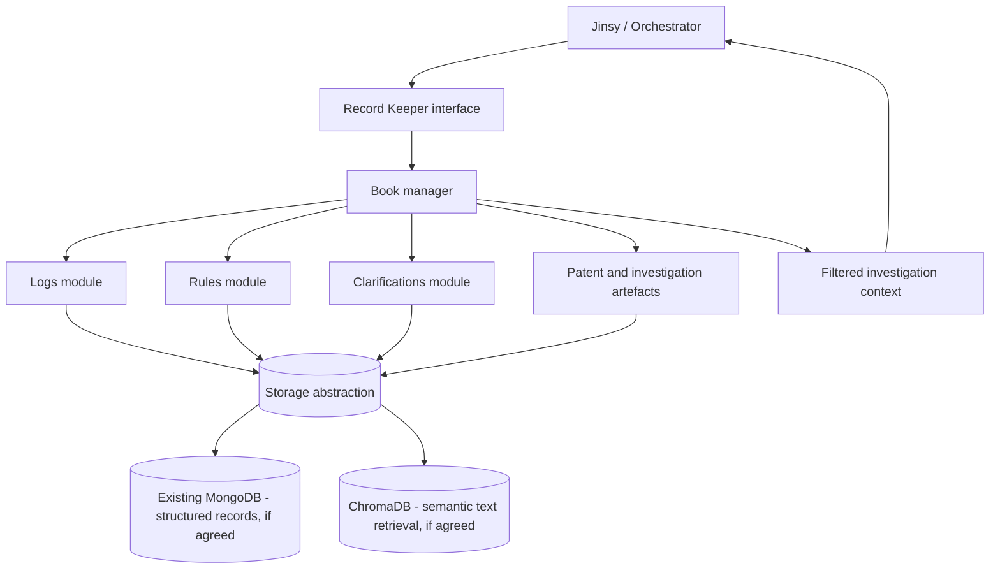
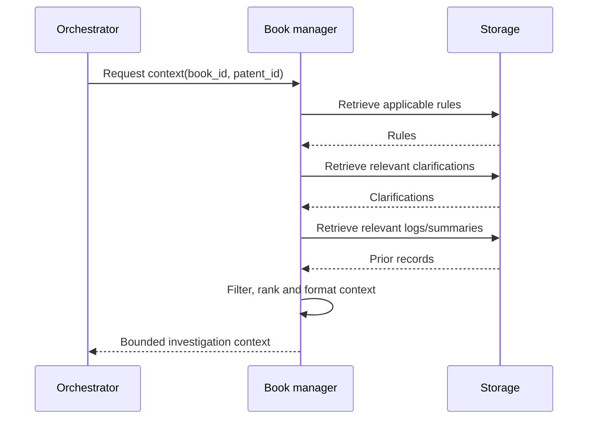
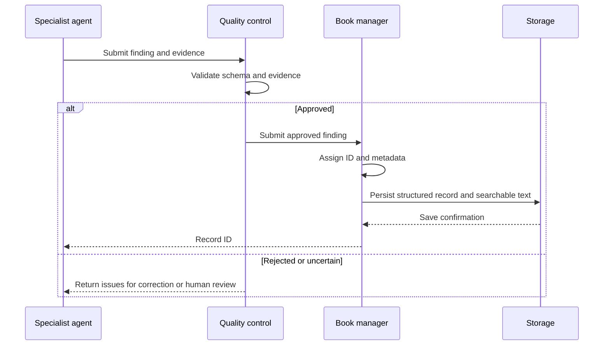

# Record Keeper Design

> **Document status:** Proposed technical design  
> **Implementation status:** Research and design phase. The functions and storage approach below are proposals based on the team's Record Keeper diagram and the team's discussion of ChromaDB. Confirm the final storage decision with the team lead before implementation.

## 1. Purpose

The Record Keeper is intended to maintain structured, patent-specific investigation information that can be retrieved by the orchestrator and specialist agents.

The team's diagram identifies four Python modules:

1. `book_structure.py`
2. `log_structure.py`
3. `rules_structure.py`
4. `clarification_structure.py`

The central concept is a **Book** (also called a workbook in the API diagram) that organises information for a patent investigation.

The Record Keeper should support continuity between investigation steps and, where permitted, between separate investigation runs.

## 2. Responsibilities from the team diagram

### 2.1 Book

The Book diagram includes these fields:

- `current_working_logs`
- `historical_log_summaries`
- `analysis_rules`
- `claim_isolation_rules`
- `claim_classification_rules`
- `clarifications_by_user`
- `patent_data`
- `infringements`
- `charts`
- `reports`
- `matrices`

Functions shown:

- `append_to_logs()`
- `summarize_logs()`
- `get_log_by_id()`
- `get_log_range_by_date()`
- `add_user_clarification()`
- `update_user_clarification()`
- `load_work_book_by_id()`
- `create_work_book()`
- `save_work_book()`

### 2.2 Logs

Fields shown:

- `id`
- `event`
- `owner`
- `responsible_agent`

Functions shown:

- `build_new_log()`
- `add_log_to_file()`
- `load_logs_from_file()`
- `load_log_by_id()`

### 2.3 Rules

Fields shown:

- `id`
- `rule_text`
- `added_by`

Function shown:

- `build_new_rule()`

### 2.4 Clarifications

Fields shown:

- `id`
- `clarification_text`
- `added_by`

Function shown:

- `build_new_clarification()`

The diagram does not specify exact data types, timestamp fields, versioning rules, ID generation, embedding model, storage format or retrieval interface. These need team agreement.

## 3. Design goals

The Record Keeper should aim for:

- **Patent-specific scope:** records must be associated with the correct patent and Book.
- **Traceability:** each record should have a stable ID and creation metadata.
- **Retrievability:** exact lookup by ID and filtered semantic retrieval where appropriate.
- **Controlled updates:** corrections and rules should have clear ownership and version history.
- **Separation of raw and validated data:** unverified agent output should not be treated as approved knowledge.
- **Integration:** the orchestrator should access memory through a small, documented interface.
- **Persistence:** information should remain available after the application restarts.
- **Privacy:** memory must be isolated by user/organisation permissions where applicable.

## 4. Proposed architecture



This diagram is a proposed design. It does not mean the current system already contains these modules or that MongoDB and ChromaDB integration has been approved.

## 5. Data model proposal

The following schemas are illustrative starting points. The team should agree on exact fields and required values.

### 5.1 Book metadata

```json
{
  "book_id": "book-001",
  "patent_id": "US-EXAMPLE",
  "title": "Example patent",
  "owner_id": "organisation-or-user-id",
  "status": "active",
  "created_at": "2026-11-14T10:00:00Z",
  "updated_at": "2026-11-14T10:00:00Z",
  "current_working_logs": [],
  "historical_log_summaries": [],
  "analysis_rules": [],
  "claim_isolation_rules": [],
  "claim_classification_rules": [],
  "clarifications_by_user": [],
  "patent_data_ref": null,
  "infringement_refs": [],
  "chart_refs": [],
  "report_refs": [],
  "matrix_refs": []
}
```

### 5.2 Log record

```json
{
  "id": "log-001",
  "book_id": "book-001",
  "patent_id": "US-EXAMPLE",
  "event": "Product source search completed",
  "owner": "team-member-or-agent",
  "responsible_agent": "product_source_miner",
  "created_at": "2026-11-14T10:05:00Z",
  "task_id": "task-001",
  "status": "completed",
  "source_refs": [],
  "validation_status": "pending"
}
```

### 5.3 Rule record

```json
{
  "id": "rule-001",
  "book_id": "book-001",
  "rule_text": "Do not state a technical match without supporting evidence.",
  "added_by": "reviewer",
  "created_at": "2026-11-14T10:10:00Z",
  "version": 1,
  "active": true,
  "scope": "product_analysis"
}
```

### 5.4 Clarification record

```json
{
  "id": "clarification-001",
  "book_id": "book-001",
  "patent_id": "US-EXAMPLE",
  "clarification_text": "The described product uses wireless charging, not wired charging.",
  "added_by": "user",
  "created_at": "2026-11-14T10:15:00Z",
  "version": 1,
  "supersedes": null,
  "status": "active"
}
```

### 5.5 Design notes

- Use generated IDs or UUIDs; do not use the patent ID as the record ID because one patent can have many records.
- Add timestamps even though the original diagram does not show them; they are important for date-range queries and auditability.
- Use `book_id` and `patent_id` consistently.
- Store source references and validation status for findings.
- Keep the original record when a meaningful correction is made; link the new version using `supersedes` or a version field.
- Avoid storing API keys, credentials or unnecessary personal data in memory.

## 6. Storage strategy: MongoDB and ChromaDB

The existing Patent Gap AI backend already uses MongoDB for cases, documents and search history. The team lead has mentioned evaluating local ChromaDB as an alternative to binary files. These facts do not yet establish the final storage architecture.

A possible hybrid approach:

| Storage | Possible responsibility |
|---|---|
| Existing MongoDB | Canonical Book metadata, exact IDs, statuses, structured records and links to application cases |
| ChromaDB | Semantic indexing and retrieval of selected text such as logs, summaries, rules and clarifications |
| Existing document storage | Original patent documents, PDFs and larger files |

If the team chooses ChromaDB as the sole store for Record Keeper records, exact lookup, metadata filtering, update/delete, versioning, backup and recovery still need to be designed.

### 6.1 ChromaDB collection proposal

- `investigation_logs`
- `historical_summaries`
- `analysis_rules`
- `user_clarifications`
- `patent_knowledge`

Potential metadata:

- `record_id`
- `book_id`
- `patent_id`
- `record_type`
- `owner_id`
- `created_at`
- `version`
- `validation_status`
- `source_ref`

**Security:** metadata filtering is useful for narrowing searches, but it is not a replacement for authentication and authorisation. Access permissions must be enforced by the application.

### 6.2 Minimal ChromaDB prototype

```python
import chromadb

client = chromadb.PersistentClient(path="./record_keeper_chroma")

logs = client.get_or_create_collection(
    name="investigation_logs"
)

logs.upsert(
    ids=["log-001"],
    documents=[
        "A previous investigation identified a product "
        "with a wireless charging feature."
    ],
    metadatas=[{
        "book_id": "book-001",
        "patent_id": "US-EXAMPLE",
        "record_type": "finding"
    }]
)

results = logs.query(
    query_texts=["Previous findings about wireless charging"],
    n_results=3,
    where={
        "book_id": "book-001",
        "patent_id": "US-EXAMPLE"
    }
)

print(results["documents"])
```

This is a learning prototype, not production-ready code. Confirm the embedding function and ChromaDB version, and test persistence, filtering and update behaviour.

## 7. Proposed Python interfaces

### 7.1 `log_structure.py`

Potential responsibilities:

- `build_new_log(...)`: construct and validate a log record.
- `add_log_to_file(...)`: persist a log through the selected storage adapter.
- `load_logs_from_file(...)`: retrieve logs for a Book, with optional filters.
- `load_log_by_id(...)`: exact lookup by log ID.

The original function names mention files. If the team adopts a database, discuss whether to rename them to storage-neutral names such as `save_log()` and `get_logs()`.

### 7.2 `rules_structure.py`

Potential responsibilities:

- `build_new_rule(...)`: construct a rule with ID, author, scope and version.
- Additional proposed methods: save, retrieve, deactivate and version a rule.

The diagram only explicitly lists `build_new_rule()`. Other methods are proposed and need agreement.

### 7.3 `clarification_structure.py`

Potential responsibilities:

- `build_new_clarification(...)`: construct a clarification.
- Additional proposed methods: save, retrieve, update/version and supersede a clarification.

The diagram only explicitly lists `build_new_clarification()`. Other methods are proposed.

### 7.4 `book_structure.py`

Potential responsibilities:

- Create and load a Book.
- Append logs.
- Retrieve logs by ID and date range.
- Summarise older logs.
- Add and update user clarifications.
- Save and load Book state.
- Provide filtered investigation context to the orchestrator.

### 7.5 Suggested interface for Jinsy

A small orchestrator-facing interface could be:

```python
def get_investigation_context(book_id: str, patent_id: str) -> dict:
    """Return relevant, permission-filtered context for an investigation."""
    ...

def save_investigation_event(book_id: str, event: dict) -> str:
    """Validate and persist an investigation event; return its record ID."""
    ...
```

These are proposed integration methods, not functions shown in the original diagram.

## 8. Memory retrieval and write lifecycle

### 8.1 Retrieval before analysis



### 8.2 Saving after analysis



The team should decide whether raw agent outputs are also retained, and who is authorised to approve records for long-term memory.

## 9. Summarisation strategy

The Book diagram includes `summarize_logs()` and `historical_log_summaries`.

A safe staged approach:

1. Keep detailed logs as the original record.
2. Select a bounded group of older logs for summarisation.
3. Generate a concise summary that preserves important findings, dates, sources and uncertainty.
4. Store the summary with the IDs of the logs it covers.
5. Keep the original logs available for audit and exact retrieval.
6. Do not allow a summary to silently replace source evidence.

A summary should be treated as a navigation aid, not as stronger evidence than the original source records.

## 10. Testing plan

### Unit tests
- Create a Book with a unique ID.
- Build a log, rule and clarification.
- Save and retrieve each record.
- Retrieve a log by ID.
- Retrieve logs within a date range.
- Update a clarification while preserving version history.
- Verify that a Book cannot retrieve another Book's records accidentally.

### ChromaDB tests
- Save a record and restart the process.
- Retrieve it after restart.
- Query by semantic similarity.
- Apply `book_id` and `patent_id` filters.
- Update an existing ID without creating an unintended duplicate.
- Handle an empty result set.
- Test behaviour when the embedding function is unavailable.

### Integration tests
- Orchestrator requests context before analysis.
- Record Keeper returns only permitted, relevant records.
- Validated findings are saved after analysis.
- Rejected findings are not marked as approved memory.
- A second investigation can retrieve relevant prior context.

## 11. Risks and design decisions

| Risk / question | Why it matters | Action |
|---|---|---|
| Local vs shared ChromaDB | Local persistence on one machine is not automatically shared with other agents on other machines | Confirm process and deployment topology |
| MongoDB overlap | Existing case/document/search data may be duplicated | Define the canonical source for each data type |
| Incorrect memory | Old or incorrect findings can mislead future analysis | Store provenance, validation status and versions |
| Cross-organisation leakage | Patent investigation data may be confidential | Enforce authorisation before retrieval |
| Embedding consistency | Different embedding models can make stored vectors incompatible or less useful | Agree and version the embedding configuration |
| Unbounded memory context | Large retrieval results can overwhelm agents and increase cost | Filter, rank and limit retrieved context |
| Updates and deletions | Corrections and retention requests must be handled consistently | Define versioning and lifecycle rules |

## 12. Open questions for the team lead and orchestrator

1. Is ChromaDB approved, or is it still under evaluation?
2. Will ChromaDB run locally in one application process or as a shared service?
3. Does MongoDB remain the canonical store for Book metadata and structured records?
4. Which collections should be created first?
5. Which embedding model will be used?
6. What is the required scope: per patent, per Book, per user or per organisation?
7. Which agent outputs are eligible for persistent memory?
8. Who validates or approves findings before they are saved?
9. How should rules and clarifications be versioned?
10. What exact interface does Jinsy need from the Record Keeper?

## 13. Technical resources

- [ChromaDB documentation](https://docs.trychroma.com/)
- [Chroma Cookbook — Core concepts](https://cookbook.chromadb.dev/core/)
- [Chroma Cookbook — Collections](https://cookbook.chromadb.dev/core/collections/)
- [Chroma Cookbook — Storage layout](https://cookbook.chromadb.dev/core/storage-layout/)
- [Python dataclasses](https://docs.python.org/3/library/dataclasses.html)
- [Python logging](https://docs.python.org/3/library/logging.html)
- [Python typing](https://docs.python.org/3/library/typing.html)
- [MongoDB Python documentation](https://www.mongodb.com/docs/languages/python/pymongo-driver/current/)

## 14. Proposed implementation milestones

| Milestone | Work | Completion evidence |
|---|---|---|
| R1 — Confirm design | Agree Book schema, IDs, storage responsibilities and ChromaDB decision | Team-approved design |
| R2 — Storage prototype | Create local persistent ChromaDB collection and test retrieval | Data survives restart and filters correctly |
| R3 — Logs | Implement log creation, persistence and retrieval | Unit tests pass |
| R4 — Rules and clarifications | Implement storage and retrieval with versioning decisions | Unit tests pass |
| R5 — Book manager | Connect modules and expose orchestrator-facing methods | Book lifecycle tests pass |
| R6 — Integration | Connect retrieval and saving with Jinsy's workflow | Integration tests pass |
| R7 — Validation | Test permissions, provenance, errors and end-to-end retrieval | Test report and reviewed design |

---

**Document note:** This is a proposed design based on the team's Record Keeper diagram and current storage discussion. Confirm the final architecture and interfaces with the team before implementation.
